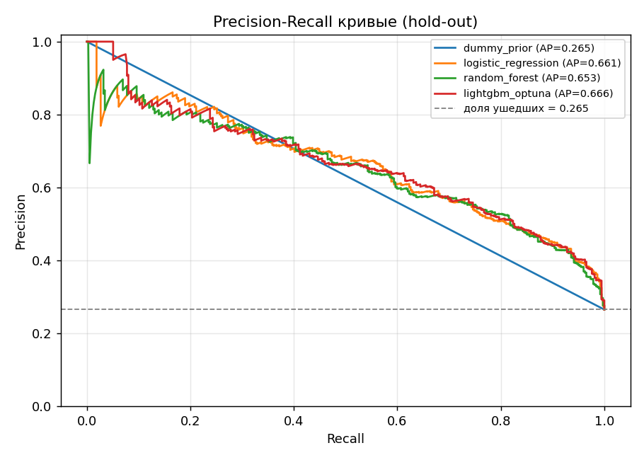
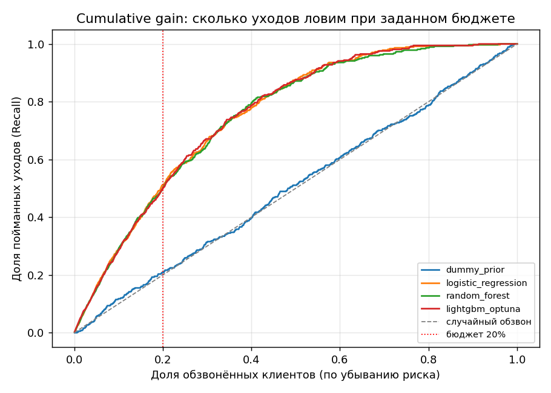
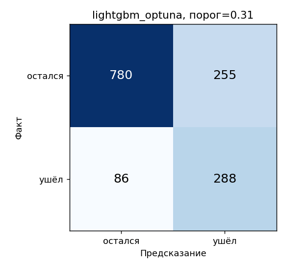
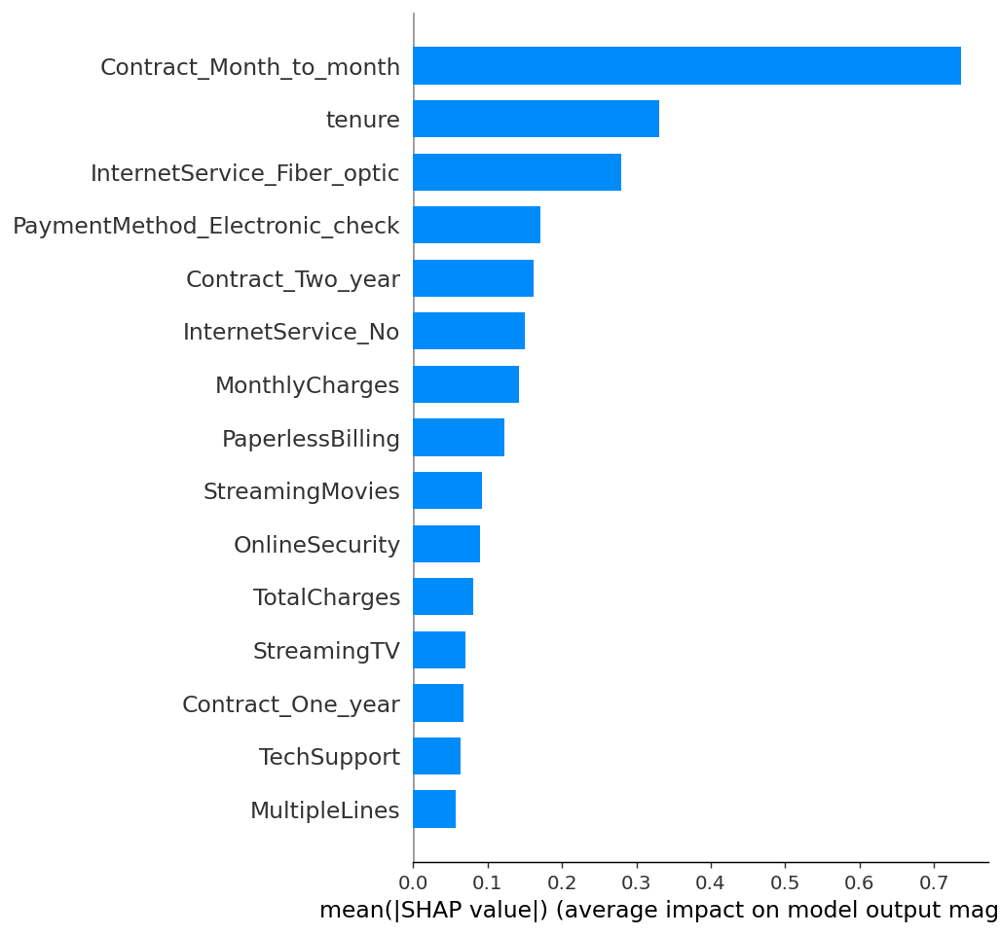
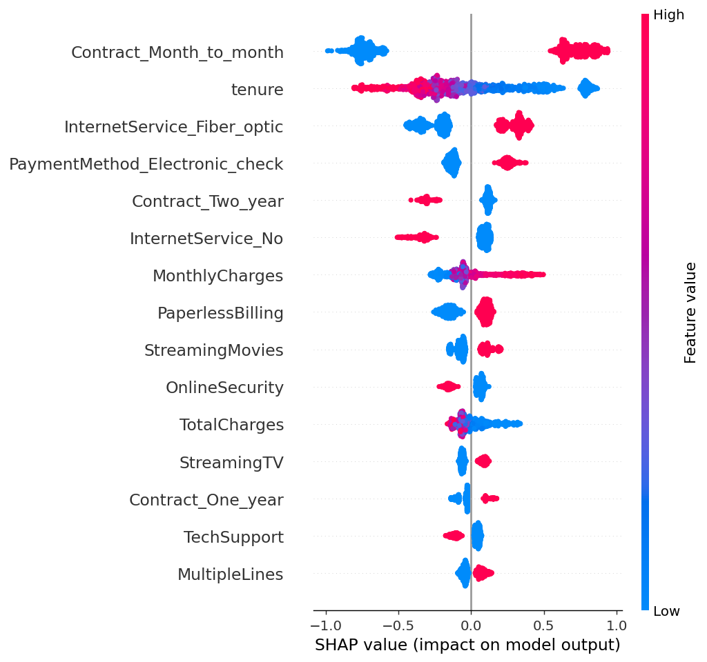
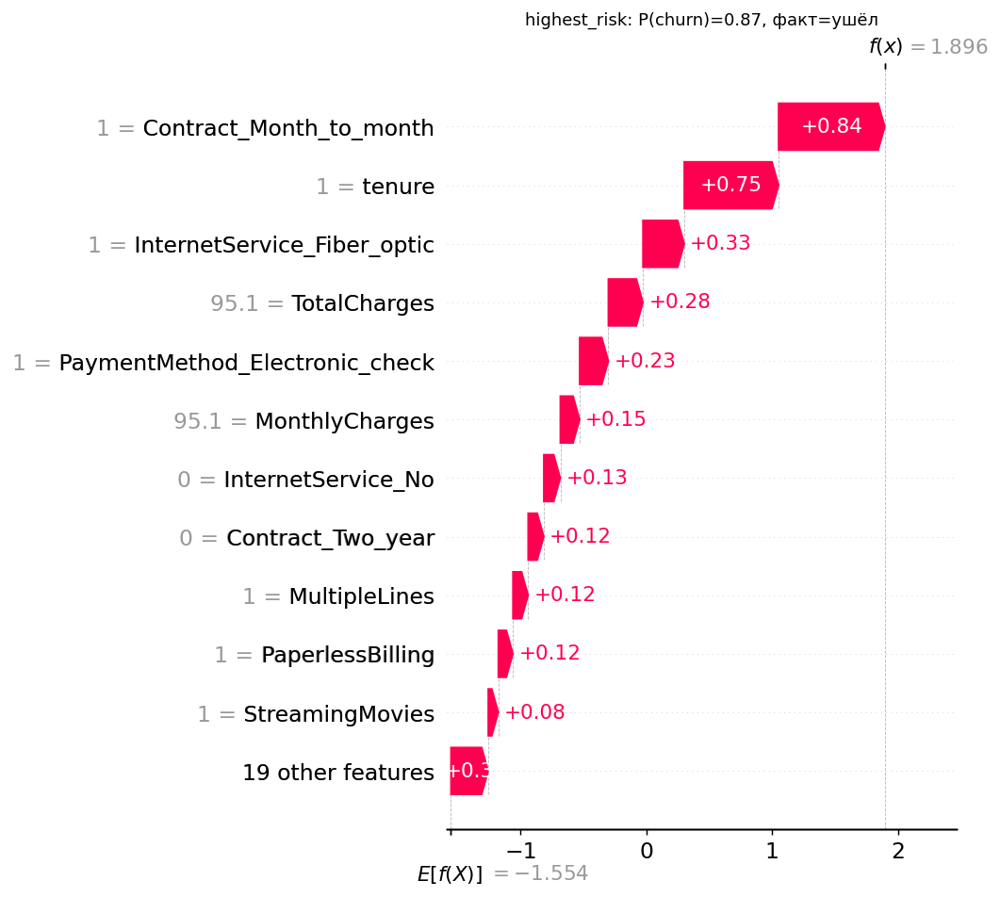
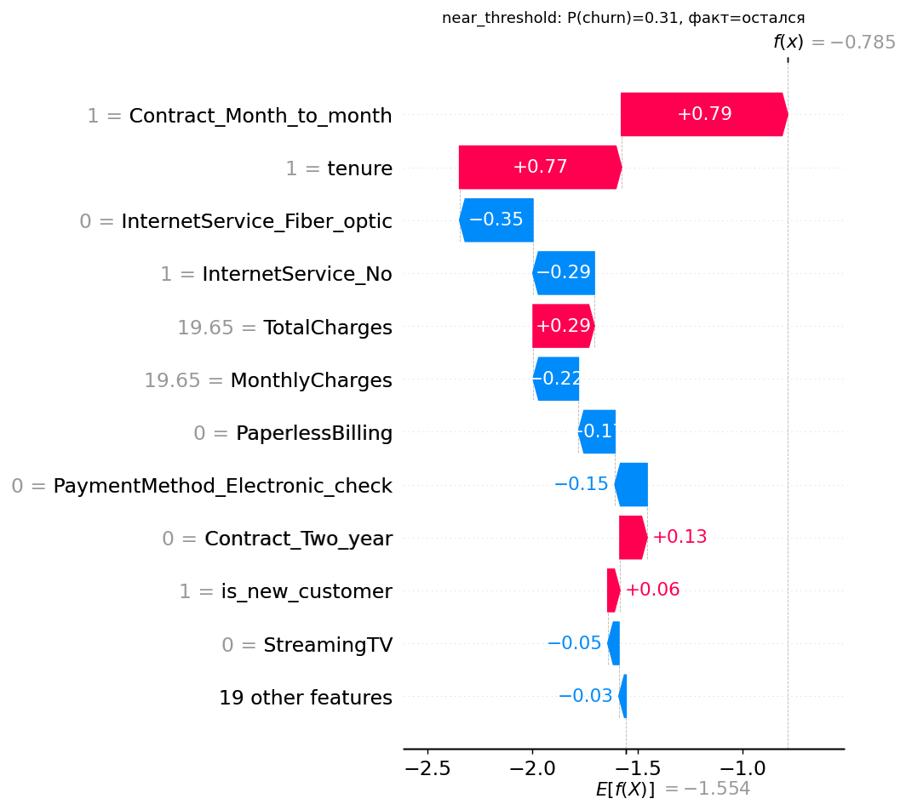
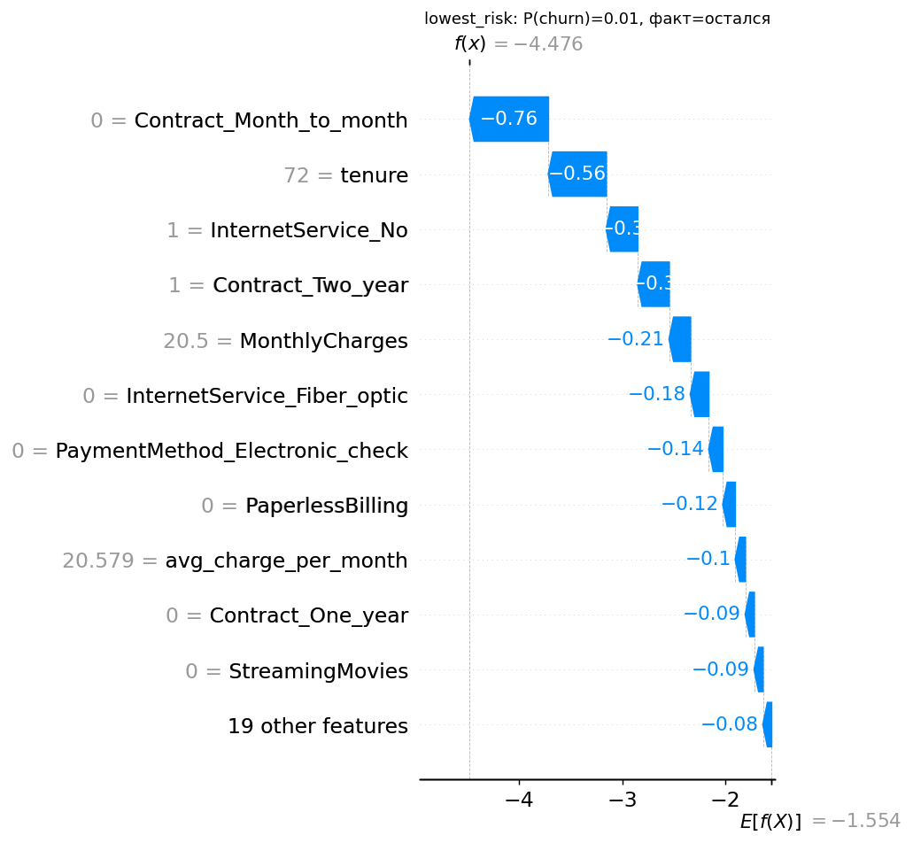

# Telco Churn: кого обзвонить в первую очередь

## Постановка задачи
Телеком-компания теряет клиентов, а удержать существующего дешевле, чем привлечь нового; при этом обзвон всех подряд дорог и раздражает. Проект строит модель, которая по данным клиента выдаёт **вероятность ухода**, чтобы отдел удержания обзванивал только клиентов из группы риска. Ключевой вопрос: *«Каких клиентов обзвонить в первую очередь, чтобы поймать максимум уходов при ограниченном бюджете?»* Поэтому качество измеряется ранжированием (**PR-AUC**) и бизнес-метрикой **Recall@20%**: какую долю реальных уходов ловим, обзвонив топ-20% клиентов по риску.

## Данные
[Telco Customer Churn (IBM)](https://www.kaggle.com/datasets/blastchar/telco-customer-churn), Kaggle `blastchar/telco-customer-churn`: 7 043 строки, 21 столбец (демография: `gender`, `SeniorCitizen`, `Partner`, `Dependents`; услуги; договор, способ оплаты, `MonthlyCharges`, `TotalCharges`; `tenure`). Возраста в датасете нет, есть только флаг `SeniorCitizen`. Target — `Churn` (Yes/No → 1/0), ≈ 26.5% ушедших / 73.5% оставшихся. Ловушка: в `TotalCharges` лежат пробелы (11 строк, все с `tenure = 0`), из-за них колонка читается как `object`.

## Результаты
Hold-out 20% (n=1409, 374 ушедших), `random_state=42`. Таблица также генерируется автоматически в `reports/results.md`.

| Модель | CV PR-AUC | PR-AUC | ROC-AUC | F1 | Recall@20% | Lift@20% |
|---|---|---|---|---|---|---|
| DummyClassifier (prior), baseline | 0.265 | 0.265 | 0.500 | 0.420 | 0.209* | 1.04* |
| LogisticRegression | 0.667 | 0.661 | 0.847 | 0.633 | 0.511 | 2.55 |
| RandomForest | 0.660 | 0.653 | 0.843 | 0.632 | 0.503 | 2.51 |
| **LightGBM + Optuna (30 trials), чемпион** | **0.669** | **0.666** | **0.848** | 0.628 | 0.500 | 2.50 |

\* у Dummy все скоры равны, поэтому «топ-20%» — произвольная выборка; честное значение для случайного обзвона ≈ 0.20 / lift 1.0.

**Выводы.**
- Модели сильно лучше baseline: PR-AUC 0.67 против 0.27, ROC-AUC 0.85 против 0.50.
- Обзвон топ-20% клиентов ловит **50% всех уходов** (precision 66%, lift ×2.5). Максимально возможное значение при таком бюджете — 75% (282 звонка на 374 ушедших), то есть модель достигает около двух третей потолка.
- LogReg, RandomForest и LightGBM практически неразличимы: разница в 0.5–1 п.п. лежит в пределах шума (на hold-out всего 374 положительных примера). LightGBM выбран по CV PR-AUC, а не по hold-out. Это типичный потолок для табличных признаков Telco.

### Графики качества (hold-out)

**Precision-Recall кривые.** Чем выше и правее кривая, тем лучше; пунктир — доля ушедших (0.265), уровень случайной модели.



**Cumulative gain.** Какая доля всех уходов поймана, если обзвонить заданную долю клиентов (по убыванию риска). Красная линия — бюджет 20%: у модели в этой точке около 50% против 20% у случайного обзвона.



**Confusion matrix** чемпиона на пороге max F1 (0.314), выбранном по OOF-предсказаниям train.



Подробности: CV PR-AUC (5 фолдов), precision/recall на выбранном пороге и Lift@20% — в `reports/results.md`.

### Метрики простыми словами
- **Precision** — из тех, кому позвонили, какая доля действительно собиралась уйти.
- **Recall** — из всех, кто реально уходит, какую долю поймали.
- **PR-кривая** — компромисс между ними: чем больше клиентов обзваниваем, тем выше recall и ниже precision. **PR-AUC** — площадь под кривой: качество ранжирования клиентов по риску без привязки к порогу (случайная модель = доле ушедших ≈ 0.265, идеал = 1.0).
- **F1** — гармоническое среднее precision и recall на конкретном пороге; сильно штрафует перекос (звонить всем даёт F1 = 0.42, а не «среднее» 0.63).
- **Recall@20%** — доля всех уходов среди топ-20% клиентов по риску: прямая бизнес-метрика при ограниченном бюджете обзвона.
- **Lift@20%** — во сколько раз обзвон топ-20% эффективнее случайного (precision топ-20% / доля ушедших).

**Протокол оценки.** Hold-out 20% (стратифицированный) используется только для финальной оценки. Гиперпараметры (Optuna) и выбор чемпиона делаются по **CV PR-AUC на train** (`StratifiedKFold(5)`), порог выбирается по **OOF-предсказаниям train**, поэтому hold-out не подсматривается. Чемпион выбирается среди «основных» моделей (RF / LightGBM); Dummy и LogReg служат ориентирами. Финальная модель обучена на train, а не на train+hold-out, чтобы метрики в `/model_info` были честными.

**Почему PR-AUC.** При 26.5% положительного класса ROC-AUC завышен обилием легко отсекаемых негативов. PR-AUC учитывает именно качество на редком классе, а baseline здесь равен доле ушедших (≈0.265), а не 0.5, поэтому прирост виден сразу.

**Порог.** Не 0.5, а два обоснованных порога, оба считаются на OOF и хранятся в `models/model_metadata.json`:
1. `f1_opt` — максимум F1 на PR-кривой: порог решения для `churn_prediction`.
2. `top20_budget` — минимальный скор клиента из топ-20%: порог бюджета обзвона, он же граница сегмента `high`.

Сегменты риска: `high` — вероятность ≥ `top20_budget`; `medium` — ≥ `f1_opt`, но ниже `high`; `low` — остальные. Если нужен другой бюджет, меняется `BUDGET_FRACTION` в `src/config.py` либо просто берётся топ-N% батча по `churn_probability`.

## Топ-факторы ухода (SHAP)
Генерируется `python -m src.explain` → `reports/shap_summary.md` и графики `reports/figures/shap_*.png` (bar, beeswarm, три waterfall для самого рискованного, пограничного и самого надёжного клиентов). Ранжирование — по mean|SHAP|, направление — по знаку корреляции значения признака и его вклада.

| # | Повышают риск ухода | Снижают риск ухода |
|---|---|---|
| 1 | `Contract_Month_to_month` — помесячный контракт | `tenure` — больший стаж |
| 2 | `InternetService_Fiber_optic` — оптоволокно | `Contract_Two_year` — двухлетний контракт |
| 3 | `PaymentMethod_Electronic_check` — электронный чек | `InternetService_No` — нет интернет-услуги |
| 4 | `MonthlyCharges` — высокий ежемесячный платёж | `OnlineSecurity` — подключена онлайн-безопасность |
| 5 | `PaperlessBilling` — безбумажный счёт | `TotalCharges` — большая накопленная сумма* |

\* `TotalCharges` во многом дублирует `tenure` (чем дольше клиент, тем больше накопленная сумма), поэтому «снижающий риск» эффект здесь — это стаж клиента, а не сумма как таковая.

**Бизнес-интерпретация:** в зоне риска — новые клиенты на помесячном контракте с дорогим оптоволокном, платящие электронным чеком. Рычаги удержания: перевод на годовой/двухлетний контракт, переход на автоплатёж, пакет онлайн-безопасности.

**Глобальная важность** (mean|SHAP| по hold-out):



**Распределение вкладов** (каждая точка — клиент; цвет — значение признака, положение по X — влияние на риск):



**Локальные объяснения** для трёх клиентов: как каждый признак сдвигает риск от среднего значения (красные — повышают, синие — понижают; вклады в log-odds).

| Самый рискованный | Около порога | Самый надёжный |
|---|---|---|
|  |  |  |

> SHAP объясняет поведение модели, а не причины в реальности: связь «признак ↔ уход» корреляционная, а не причинная. Коррелирующие признаки (`tenure` и `TotalCharges`) делят вклад между собой.

## Как запустить

### Локально
```bash
python -m venv .venv && source .venv/bin/activate
make install                    # pip install -r requirements.txt
make data                       # скачать датасет с Kaggle (нужен ~/.kaggle/kaggle.json) или положить CSV в data/raw/
make eda                        # reports/eda/*.png + reports/eda_summary.md
make train                      # Optuna (30 trials) + MLflow → models/churn_model.pkl, reports/results.md
make explain                    # SHAP → reports/figures, reports/shap_summary.md
make serve                      # http://localhost:8000/docs
make test
make mlflow-ui                  # http://localhost:5000 (эксперименты, метрики, артефакты)
```
Без доступа к Kaggle пайплайн можно проверить на синтетике: `make synthetic` (метрики на ней **ничего не значат**).

### Docker
```bash
# 1) обучить модель (один раз; нужен data/raw/*.csv)
docker compose --profile train run --rm trainer
# 2) поднять сервис
docker compose up --build        # → http://localhost:8000
# (опционально) MLflow UI
docker compose --profile mlflow up mlflow    # → http://localhost:5000
```
Модель монтируется в контейнер как том (`./models`), поэтому переобучение не требует пересборки образа. Без модели сервис стартует, `/health` отвечает `ok`, а `/predict` возвращает 503 с понятным сообщением.

### API
```bash
curl -s localhost:8000/health
curl -s -X POST localhost:8000/predict -H 'Content-Type: application/json' -d '{
  "gender":"Female","SeniorCitizen":0,"Partner":"Yes","Dependents":"No","tenure":1,
  "PhoneService":"No","MultipleLines":"No phone service","InternetService":"DSL",
  "OnlineSecurity":"No","OnlineBackup":"Yes","DeviceProtection":"No","TechSupport":"No",
  "StreamingTV":"No","StreamingMovies":"No","Contract":"Month-to-month","PaperlessBilling":"Yes",
  "PaymentMethod":"Electronic check","MonthlyCharges":29.85,"TotalCharges":29.85}'
# → {"churn_probability":0.73,"churn_prediction":1,"risk_segment":"high"}
```
| Эндпоинт | Назначение |
|---|---|
| `GET /health` | `{"status":"ok"}` |
| `POST /predict` | один клиент → вероятность, предсказание, сегмент (`customerID` опционален и возвращается как есть) |
| `POST /predict_batch` | JSON-массив клиентов (1–10 000) → массив предсказаний |
| `GET /model_info` | версия, дата обучения, пороги, метрики на hold-out |

Невалидный вход (тип, значение, диапазон, лишнее/отсутствующее поле) → `422`; модель не загружена → `503`; непредвиденная ошибка → `500` c `request_id` (детали в логе). Логи JSON (structlog): метод, путь, статус, время, `request_id`.

## Feature Engineering (`src/features.py`)
Весь FE — один sklearn-трансформер `ChurnFeatureEngineer` внутри `Pipeline`; он сохраняется вместе с моделью и одинаково применяется при обучении и в API (тест `test_train_inference_consistency`).

| Решение | Обоснование |
|---|---|
| `TotalCharges`: пробел → NaN → `MonthlyCharges × tenure` | пустые только у `tenure=0`, значит реальный итог = 0; медиана исказила бы «нового клиента» |
| Yes/No → 1/0; «No internet/phone service» → 0 | информация уже в `InternetService`/`PhoneService`; иначе идеальная мультиколлинеарность |
| One-hot: `InternetService`, `Contract`, `PaymentMethod` | нет порядка; фиксированный набор уровней → стабильные колонки в inference |
| Выбросы: winsorizing верхнего хвоста `TotalCharges`, `avg_charge_per_month` (99.5-й перцентиль train) | ошибок в данных нет, но хвост скошен; режем, не трансформируем: деревьям монотонные преобразования не нужны, а сервис защищён от аномальных входов |
| `avg_charge_per_month = TotalCharges / (tenure+1)` | реальный средний чек; разница с `MonthlyCharges` — сигнал недавней смены тарифа |
| `num_services` | число доп. услуг — вовлечённость клиента |
| `is_new_customer = tenure < 6` | пик оттока в первые месяцы, нелинейность по tenure |
| `has_autopay` | автоплатёж снижает трение и риск ухода |

## Структура репозитория
```
churn-retention/
├── data/raw/                 # сюда кладётся CSV (в git не попадает)
├── data/processed/           # hold-out для SHAP
├── models/                   # churn_model.pkl + model_metadata.json
├── reports/                  # results.md, eda_summary.md, shap_summary.md, figures/, eda/
├── mlflow/                   # sqlite-БД и артефакты экспериментов
├── scripts/                  # download_data.py, make_synthetic_data.py
├── src/
│   ├── config.py             # пути, константы, схема данных
│   ├── data.py               # загрузка + строгая валидация
│   ├── features.py           # ChurnFeatureEngineer (единый FE)
│   ├── metrics.py            # PR-AUC, Recall@K, пороги
│   ├── train.py              # Dummy / LogReg / RF / LightGBM+Optuna, MLflow
│   ├── explain.py            # SHAP
│   ├── eda.py                # EDA
│   ├── predict.py            # ChurnPredictor (сегменты риска)
│   ├── schemas.py            # Pydantic-схемы
│   ├── api.py                # FastAPI
│   ├── plots.py, synthetic.py
├── tests/                    # данные, FE, метрики, API
├── Dockerfile                # multi-stage: builder → trainer / runtime
├── docker-compose.yml        # api (+ trainer, mlflow через profiles)
├── requirements*.txt, Makefile, pytest.ini
```

## Воспроизводимость
`random_state=42` везде (split, CV, Optuna `TPESampler`, модели); LightGBM в режиме `deterministic`; версии библиотек запинены, а используемые при обучении версии записываются в `model_metadata.json`.
